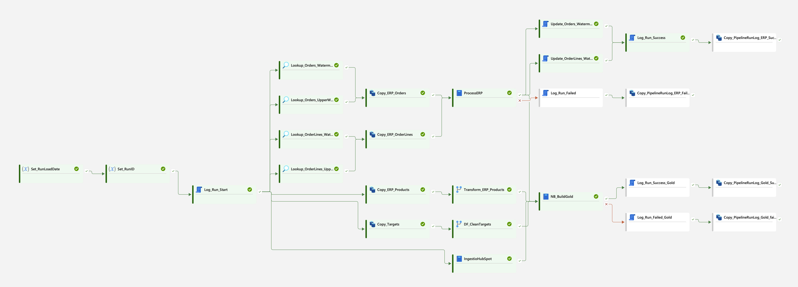

# Microsoft Fabric — End-to-End Data Pipeline Monitoring

An end-to-end data engineering and operational monitoring project built with **Microsoft Fabric, Azure SQL, PySpark, Delta Lake and Power BI**.



## Business problem

Data pipelines can fail because of invalid source records, transformation errors or downstream validation issues. A successful refresh alone does not explain which stages ran, whether data quality checks passed or how performance changes over time.

This project builds an automated ingestion and transformation pipeline with run-level logging and a Power BI report to make execution outcomes visible.

> **Project focus:** operational pipeline health and data quality monitoring, not a commercial sales performance dashboard.

## Solution overview

The solution integrates ERP data from Azure SQL, product and target datasets, and HubSpot company data. Microsoft Fabric orchestrates ingestion, transformations and validation across Bronze, Silver and Gold layers. Operational logs are surfaced in Power BI.

**Flow:** Sources → Fabric pipeline → Bronze → validated Silver → six Gold tables → logging tables → Power BI monitoring report.

### Technology

- **Microsoft Fabric:** Data Factory pipelines, Dataflows Gen2, notebooks, Lakehouse and OneLake
- **Azure SQL Database:** ERP source tables and pipeline run logging
- **PySpark / Python:** incremental processing, transformations and data-quality checks
- **Delta Lake:** Silver and Gold storage
- **HubSpot API / Azure Key Vault:** external company ingestion and secret management
- **Power BI / DAX:** monitoring semantic model, KPIs and reporting

## Data pipeline

The `PL_DailyIngestion` pipeline coordinates:

1. **Run initialization:** create a RunID and record pipeline start.
2. **ERP ingestion:** retrieve watermarks and copy orders and order lines from Azure SQL.
3. **ERP processing:** execute the `ProcessERP` notebook, validate records and prevent invalid data from being committed to Silver.
4. **Other sources:** ingest products and targets; run their transformations and HubSpot company ingestion.
5. **Gold processing:** execute `NB_BuildGold` to create and validate curated tables.
6. **Monitoring:** record success/failure paths and copy pipeline logs into the Lakehouse for reporting.

The six Gold tables are `gold_dimcustomer`, `gold_dimdate`, `gold_dimproduct`, `gold_dimsalesperson`, `gold_factorderline` and `gold_facttarget`.

## Data quality and failure handling

Examples of implemented checks include:

- Missing required identifiers and other mandatory fields
- Duplicate order-line identifiers
- Invalid values such as **Quantity ≤ 0** or negative unit prices
- Per-table Gold validation outcomes and processed row counts
- Failure paths that capture an error and log pipeline status

**Failure test:** An ERP order line was deliberately changed to have `Quantity = 0`. The ERP notebook rejected the invalid data with *“Transactional validation failed. Silver tables will NOT be updated.”* The monitoring report recorded the failed pipeline run and its error.

After correcting the source data and running the pipeline again, the execution completed successfully.

**Important distinction:** If ERP validation fails before the Gold notebook runs, the most recent Gold validation records can still show `PASS` from an earlier run. The report therefore needs a run-aware Gold status measure to distinguish **PASS**, **FAIL** and **NOT RUN** for the latest pipeline execution.

## Monitoring report

The Power BI report is designed to show:

- Total pipeline runs and success/failure rates
- Latest run timestamp, status, duration and error message
- Seven-day and 30-day success rates and comparisons
- Successful and failed runs by date
- Gold validation success rate and counts
- Per-Gold-table status and rows processed, with latest-run measures

The semantic model uses `PipelineRunLog` together with `goldvalidationlog`, `gold_monitoringlog` and `gold_dimdate`.

## Demonstrated test scenarios

| Scenario | Expected behaviour | Observed outcome |
| --- | --- | --- |
| Valid new ERP orders/order lines | Incremental ingestion and Gold update | New order lines appeared in `gold_factorderline` |
| Invalid ERP quantity (`0`) | Reject Silver update; record failure | ERP notebook failed validation and the monitoring report showed a failed run |
| Corrected source and rerun | Successful end-to-end processing | Pipeline succeeded and Gold validations reported PASS |

## Repository structure

```text
.
├── README.md
├── dashboard.png
└── docs/
    └── architecture-and-pipeline-notes.md  # optional future documentation
```

This repository currently documents the solution. Fabric notebook and pipeline exports can be added separately if they are safe to share.

## Security and reproducibility

This is a portfolio demonstration using fictional/test business data. **Do not publish** live API tokens, Key Vault secrets, database passwords, connection strings, tenant identifiers or customer information.

To reproduce the project, you would need your own Fabric workspace, source datasets, Azure SQL database and appropriate API credentials. The README describes the architecture but is not a one-click deployment package.

## Next improvements

- Complete and verify latest-run-aware Gold table status and row-count measures
- Improve the monitoring report layout and failure diagnostics
- Add sanitised architecture diagrams and selected Fabric notebook/pipeline exports
- Document the setup and deployment process
